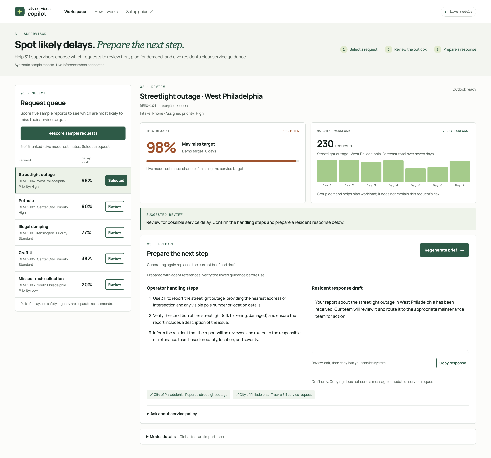

# City Services Copilot

An end-to-end city-services demo: AutoML predicts 311 resolution risk and demand, while AutoRAG turns service guidance into operator next steps and resident-response drafts.

This is the single setup guide. Use the fast path for an automated deployment; the later sections describe the individual steps for manual setup and troubleshooting.

## What the sample app looks like

The app starts with five bundled sample 311 requests. Score the queue to rank estimated SLA-miss risk, select a request to review its seven-day demand outlook, then generate operator handling steps and a resident-response draft using service guidance.



The screenshot shows live model estimates for synthetic sample reports and an agent-generated draft with references. Results vary by model and run.

## The use case: help 311 teams triage service requests

City service teams receive more requests than they can inspect or resolve at once. A supervisor needs to know which new requests are likely to miss their service target, how much work is approaching, and what the resident should expect next. Those answers usually live in separate places: an operations dataset, a forecasting process, and public service guidance.

This demo brings those views together around one representative scenario: a resident reports illegal dumping in a neighborhood. The operator scores five fixed sample reports, selects one, then reviews:

- **Resolution-risk prediction:** a tabular AutoML model classifies whether the request misses its SLA. Live mode shows the estimated probability of an SLA miss, the class at a 50% cutoff, and the service SLA target. Sample mode shows illustrative delay risk and the same fixed demo service target.
- **Demand forecast:** an AutoML time-series model forecasts the seven days after the bundled history for the selected service and neighborhood. The chart uses relative Day 1–Day 7 labels so the sample needs no calendar-date maintenance.
- **Operator guidance:** AutoRAG prepares handling steps and a resident-response draft using the selected service, neighborhood, intake channel, and assigned priority. Source links appear when returned by the agent; generated references, structured citations, and bundled sample guidance have distinct labels. A follow-up question remains available.

The bundled fixtures are synthetic and the sample-mode results are illustrative. The demo is designed to show the integration pattern—not to make operational decisions or represent live City of Philadelphia service levels. In a production deployment, replace the fixtures with approved, governed data; validate performance and fairness; and connect the app to the selected deployed model and RAG pattern.

> **Verified pipeline source:** [`opendatahub-io/pipelines-components`](https://github.com/opendatahub-io/pipelines-components) `main` at [`3a8f9a1`](https://github.com/opendatahub-io/pipelines-components/tree/3a8f9a1c25b06c58a30082eb28ba6d9a2295f14b), checked 2026-09-30. Dashboard labels can differ; use the parameter names below as the source of truth.

## Fast path: run the included demo

The repository already contains safe, synthetic fixture CSVs, a twenty-two-document AutoRAG guidance corpus, and evaluation data. For a first end-to-end run, do **not** download, transform, or prepare data.

After the [platform prerequisites](#1-prerequisites) and [AutoRAG deployment prerequisites](#deploy-and-connect-the-best-autorag-starter-kit) are ready:

1. Create their private environment file and install the runner dependencies:

   ```bash
   cp .env.example .env
   python3 -m pip install -r requirements-cluster.txt
   ```

   Fill only the values shown in `.env`: cluster URL, token, project, S3 endpoint/credentials/bucket, one shared `S3_CONNECTION_NAME`, MaaS/vector-database connection names, and MaaS model IDs. The runner discovers the existing `ds-pipeline` Route from `RHOAI_URL` and derives the remaining demo defaults.

2. Preview the plan, then upload, train, deploy, and test all three services:

   ```bash
   python3 scripts/setup_demo.py --auto-deploy --dry-run
   python3 scripts/setup_demo.py --auto-deploy --apply
   ```

3. After deployment succeeds, start the app with `python3 main.py`, then open `http://localhost:8000`. Restart an already running backend to load the saved endpoints and credentials.

For a local preview without a cluster, run `python3 main.py` with no `app-config.json`. The app labels its results as sample estimates and sample guidance.

The repository contains deterministic synthetic fixtures with 5,000 tabular rows, 7,300 time-series rows across all 20 service/neighborhood series, twenty-two guidance documents, and thirteen AutoRAG evaluation questions. The CSVs exceed the AutoML 1,000-record minimum and make a more realistic pipeline exercise. They are still not intended to produce credible quality metrics. Recreate the CSVs with `python3 scripts/generate_demo_fixtures.py` if needed.

### Guided setup

Prefer a prompt-driven flow? Run:

```bash
python3 scripts/setup_demo.py
```

After you create `.env` from `.env.example`, the wizard runs the same dry-run preflight, shows the submission or deployment plan, and asks for confirmation before making changes. Use `--dry-run` to stop after the preview, or `--apply` to accept that plan without a prompt. `--apply` alone submits pipelines; add `--auto-deploy` to complete deployment and app configuration as well:

```bash
python3 scripts/setup_demo.py --auto-deploy --dry-run
python3 scripts/setup_demo.py --auto-deploy --apply
```

This uploads the bundled inputs, submits and monitors all three pipelines, deploys the best tabular and time-series predictors, deploys the generated AutoRAG starter kit, tests authenticated scoring and guidance, and saves all three endpoints and their tokens to private `app-config.json`. AutoRAG requires an OpenShell gateway already installed on the cluster; the runner refreshes its mTLS certificates and registers it locally as `openshift` when needed. Local dependencies and platform prerequisites are listed below. Use `--only tabular`, `--only timeseries`, or `--only autorag` with `--auto-deploy` to complete one pipeline. `--auto-deploy-automl` and `--auto-deploy-autorag` select which results to deploy after submission.

To finish existing successful runs without uploading data or retraining, use `--deploy TABULAR_RUN_ID TIMESERIES_RUN_ID`; the setup wrapper automatically waits for readiness and tests both models. Add `--deploy-autorag AUTORAG_RUN_ID` to deploy guidance in the same command. An already connected AutoRAG endpoint is preserved when deploying only AutoML.

Replace every `*_RUN_ID` placeholder with an actual successful run ID from your pipeline results. Do not pass the placeholder literally.

### Rerun without uploading data

Choose whether you need a new optimization run or only deployment:

| Goal | Command |
| --- | --- |
| Rerun all three pipelines and deploy their new results | `python3 scripts/setup_demo.py --skip-upload --auto-deploy --apply` |
| Rerun only AutoRAG optimization and deploy its new result | `python3 scripts/setup_demo.py --only autorag --skip-upload --auto-deploy-autorag --apply` |
| Redeploy an existing successful AutoRAG run | `python3 scripts/setup_demo.py --deploy-autorag AUTORAG_RUN_ID --apply` |
| Redeploy existing successful AutoML runs | `python3 scripts/setup_demo.py --deploy TABULAR_RUN_ID TIMESERIES_RUN_ID --apply` |

Use `--skip-upload` only when the same input objects already exist at the configured bucket and keys. Redeployment reads existing run artifacts and does not submit pipelines, upload fixtures, or re-index documents. Add `--dry-run` to preview any command. Restart the app after its configuration changes.

### Automated cluster run

To upload the bundled fixtures and submit all three managed pipeline runs from one `.env` file, use the included cluster runner. Its KFP managed-pipeline lookup and bearer-token authentication follow the current [AutoX CI](https://github.com/red-hat-data-services/autox-ci) approach.

```bash
python3 -m pip install -r requirements-cluster.txt
cp .env.example .env
# Edit only the values shown in .env.example.
python3 scripts/run_cluster_demo.py --dry-run
python3 scripts/run_cluster_demo.py
```

The dry run validates the bundled data and configuration, then shows a compact submission plan—pipeline, S3 inputs, existing connection names, targets, and selected models—without writing to the cluster. Add `--show-parameters` only when troubleshooting and you need the full KFP parameter JSON. The normal command uploads the bundled synthetic CSVs, documents, and evaluation JSON; then submits the tabular AutoML, time-series AutoML, and AutoRAG managed pipelines. After submission in an interactive terminal, it asks whether to watch all runs. Successful runs offer deployment of the best AutoRAG starter kit and selected AutoML models; deployment prompts default to **No**. Use `--wait` to start watching without the first prompt, `--non-interactive` for unattended submission, `--only tabular`, `--only timeseries`, or `--only autorag` to run one pipeline, and `--skip-upload` only after a successful upload. Add `--auto-deploy` to wait and deploy all selected results without further prompts. Automated deployment attempts both AutoML and AutoRAG even if one deployment fails, and exits unsuccessfully if any requested step remains incomplete.

### Optional advanced configuration

The short `.env.example` is the supported default. Add an override only when the default does not match your platform: `RHOAI_KFP_URL` for a direct pipeline URL; `AUTOML_S3_SECRET_NAME`, `AUTORAG_TEST_S3_SECRET_NAME`, `AUTORAG_DOCUMENTS_S3_SECRET_NAME`, or `AUTOML_KSERVE_STORAGE_KEY` when those stages use different S3 connections; `PIPELINE_ARTIFACTS_S3_BUCKET` and `PIPELINE_ARTIFACTS_S3_PREFIX` when artifacts are stored separately; or the TLS, runtime, pipeline-name, and preset variables documented inline in `scripts/run_cluster_demo.py`. Existing `.env` files using the former specific S3 variables remain supported.

### Monitor submitted runs and leaderboards

Use the submitted run IDs to check status without resubmitting anything:

```bash
python3 scripts/run_cluster_demo.py --status TABULAR_RUN_ID TIMESERIES_RUN_ID AUTORAG_RUN_ID --watch
```

The monitor prints each KFP run as a compact status block, followed by a ranked leaderboard table once it succeeds. During `--watch` in an interactive terminal, it prints each run link once and then uses one in-place spinner while it waits for the next poll, rather than repeating unchanged running states. Successful states and the best row are highlighted; redirected logs stay readable and print only state changes. It also prints any AutoML HTML leaderboard location and the AutoRAG pattern-artifact location. By default, artifact lookup uses `AWS_S3_BUCKET`; set `PIPELINE_ARTIFACTS_S3_BUCKET` and, if applicable, `PIPELINE_ARTIFACTS_S3_PREFIX` when pipeline artifacts are stored elsewhere. Artifact retrieval uses the same S3 credentials in `.env`.

### Deploy the selected AutoML models

After the tabular and time-series runs have succeeded, the runner can select each run's highest-scoring predictor artifact and create a persistent KServe `InferenceService` for it:

```bash
python3 scripts/run_cluster_demo.py --deploy TABULAR_RUN_ID TIMESERIES_RUN_ID --wait-deploy
# Equivalent guided entry point, with a dry-run preflight and automatic readiness wait:
python3 scripts/setup_demo.py --deploy TABULAR_RUN_ID TIMESERIES_RUN_ID --apply
```

Add `--dry-run` to inspect the chosen model and generated `InferenceService` manifest without creating anything; it reads KFP run status and model artifacts from object storage. Each run must have succeeded before serving resources are created.

With `--wait-deploy` in an interactive terminal, readiness is shown with one in-place spinner rather than repeated KServe status lines. It prints the endpoint URL once the service is ready.

This is an explicit cluster write: for each endpoint, it clones the OpenShift AI `autogluon-runtime-template` into a namespace-scoped `ServingRuntime` with the same name, waits for KServe to index it, then creates the matching `InferenceService` in `RHOAI_PROJECT_NAME`. It preserves the template's dashboard metadata, so the OpenShift AI dashboard identifies it as **AutoGluon ServingRuntime for KServe** rather than an unknown runtime; re-running `--deploy` repairs that metadata on an existing demo runtime. The command reuses the one existing object-storage connection named by `S3_CONNECTION_NAME` for AutoML, AutoRAG, and KServe deployment; its default service account is `<S3_CONNECTION_NAME>-sa`. That connection must have read access to the pipeline-artifact bucket. To reuse a platform-provided runtime instead, set `AUTOML_SERVING_RUNTIME_NAME` and set `AUTOML_CREATE_SERVING_RUNTIME=false`. The AutoML deployment path does not create or alter secrets, service accounts, or Model Registry records. The tabular InferenceService sets `PREDICT_PROBA=true`, supported by the [AutoGluon runtime](https://kserve.github.io/website/docs/model-serving/predictive-inference/frameworks/autogluon); existing tabular services are reconciled on redeployment. The shared ServingRuntime and time-series service are unchanged.

When deployed services become ready, the runner makes authenticated predictions using the app's actual tabular and forecast payloads and response adapters. Only after every ready endpoint passes does it atomically update the owner-only, Git-ignored `app-config.json` (or `DEMO_APP_CONFIG_PATH`) with KServe v1 scoring URIs and per-endpoint copies of the existing `RHOAI_TOKEN`. A failed check leaves the app configuration unchanged. It preserves the AutoRAG `responses` endpoint, token, CA, and TLS settings. For the tabular model, it also copies the selected predictor's persisted global permutation feature importance from `metrics/feature_importance.json`. The app converts the UI request into the AutoGluon training schema and KServe `instances` payload, and adapts the native prediction response back to the UI. The AutoGluon KServe v1 runtime requires list-wrapped values inside each tabular `instances` record; scalar fields are intentionally not used.

### Deploy and connect the best AutoRAG starter kit

For an already successful AutoRAG run, use:

```bash
python3 scripts/setup_demo.py --deploy-autorag AUTORAG_RUN_ID --dry-run
python3 scripts/setup_demo.py --deploy-autorag AUTORAG_RUN_ID --apply
```

The first command reads the run and its artifacts, downloads the archive into a temporary directory, and validates the generated kit configuration. It does not build, deploy, or change the app configuration. The second command performs the deployment. The runner also accepts `python3 scripts/run_cluster_demo.py --deploy-autorag AUTORAG_RUN_ID` directly.

For submission through deployment without further prompts:

```bash
python3 scripts/setup_demo.py --only autorag --auto-deploy-autorag --apply
```

Current starter kits require a ready Red Hat OpenShell gateway in the cluster's `openshell` namespace and the Red Hat build of the Agent Sandbox operator. Install `oc`, `podman`, `uv`, `make`, `curl`, and Python locally. Podman must be running; on macOS, start its machine if needed. The kit runs the RHOAI CLI in a container, so a local OpenShell CLI installation is no longer required. `make refresh-certs` retrieves mTLS certificates and registers the cluster gateway as `openshift`. Gateway installation remains a separate administrator prerequisite. The OpenShift internal image registry must be available, the generation model must support tool calling, and the pattern's collection must already be indexed.

The runner uses one deployment runtime: the bundled ai4rag v0.25.4 [downstream templates](https://github.com/IBM/ai4rag/tree/e9472f1b72d9486c23f07f6390b55dac66468fe9/ai4rag/assets_generator/starter_kit_templates/agentic_rag), verified 2026-11-04, with local adjustments recorded in `scripts/autorag_runtime/PROVENANCE.md`. For each deployment, it prepares `Makefile`, `Containerfile.openshell`, `proxychains_entrypoint.py`, and `README.md` from this bundled runtime. The archive's original deployment files and source provenance remain outside the image build context in `original-runtime/`. The optimized `agentic_rag` application, configuration, and collection come from the selected successful run.

The runner:

1. Requires a successful KFP run and searches its entire artifact prefix for the run's generated `starter_kit.zip`, including outputs stored above the individual pattern directories.
2. Downloads that archive from the configured artifact bucket, rejecting missing/ambiguous archives. The pipeline already generates the kit using the best pattern's defaults; deployment does not rank or compare individual `pattern.json` files. Older runs without a generated kit need a new pipeline run.
3. Preserves the generated `agent_config.json`, prompts, retrieval settings, models, collection, and application code. It uses the kit's MaaS/database connection names, filling missing values from `.env` or applying explicit deployment overrides. It does not upload or re-index documents. The downstream kit inherits the supported sandbox image's policy and adds MaaS/database egress after readiness.
4. Validates gateway readiness, runs `make refresh-certs`, and checks authentication through the same containerized RHOAI CLI used for deployment. It runs `uv lock --upgrade-package ai4rag`, then `make build-openshell OPENSHELL_IMAGE=city-services-rag`. The kit discovers both CLI and sandbox images from the latest successful RHOAI CSV. Its Containerfile builds the Python 3.12 application on UBI and copies it into the downstream sandbox base. OpenShift builds and pushes the agent image; Podman runs only the CLI. The kit starts a local CONNECT proxy for Milvus gRPC and native database traffic under OpenShell's egress policies.
5. Polls the submitted OpenShift Build until it completes, fails, or reaches the deployment timeout, even if the build log stream disconnects. A log-stream interruption alone does not fail deployment. It then runs `make deploy-openshell OPENSHELL_IMAGE=city-services-rag`. This creates/replaces the configured demo sandbox, starts the agent, configures egress, exposes the Route, and creates the kit's client service account/token secret.
6. Discovers the `openshell/openshell-rag-agent` Route and the demo project's `agent-client-token` secret, waits for `/health`, and requires an authenticated `/v1/responses` answer to a city-services question. Unless an explicit CA bundle is configured, it saves the gateway CA from `openshell-client-tls` outside the build context and uses it to verify the agent Route and subsequent app requests.
7. Atomically merges `endpoints.responses`, `endpoint_tokens.responses`, `responses_auth_header: "X-Api-Key"`, and endpoint TLS settings into the private app configuration. It removes any old BFF template and preserves existing AutoML URLs, tokens, and feature importance. Restart `python3 main.py` to load it.

Deployment files and a private log remain under Git-ignored `run-results/autorag/`. The temporary kubeconfig is outside the image build context, targets `RHOAI_URL` and `RHOAI_PROJECT_NAME`, and is removed after deployment. App credentials and logs use owner-only file permissions. A failed build or endpoint check leaves the app configuration unchanged; cluster resources already created remain available for inspection. Re-running deployment rebuilds the image and replaces the demo sandbox. The kit shares the Route name, `agent-client` service account, and `agent-client-token` secret, so run one demo deployment at a time. It requests 168-hour client/reviewer tokens; cluster policy may shorten their lifetime. Re-deploy before token expiry.

#### Deployment namespaces and Agent Ops

`RHOAI_PROJECT_NAME` selects the pipeline, image-build, connection-secret, and agent-client-token project. The gateway manages the Sandbox in its own namespace, `openshell`; with the default sandbox name, its Kubernetes resource is `default--city-services-rag`. Changing the current `oc` project does not move it. In Agent Ops, select **All projects** or **openshell** to see this deployment.

The original v0.25.4 starter-kit template hardcodes `openshell`; it is not an empty field the user must fill. Our prepared Makefile adds `OPENSHELL_NAMESPACE`, defaulting to `openshell`, for standalone use with another existing gateway. The demo runner still validates and discovers gateway resources in `openshell`; other gateway namespaces are not supported by its complete deployment flow.

The agent uses LangChain. The starter-kit deployment currently omits the top-level Sandbox annotation `opendatahub.io/agent-framework: langchain`, so Agent Ops may leave **Framework** blank. The generator fix is tracked in [RHAI-19949](https://redhat.atlassian.net/browse/RHAI-19949). To set it on an existing default demo deployment, using `oc` authenticated to the intended cluster:

```bash
oc annotate sandbox default--city-services-rag -n openshell opendatahub.io/agent-framework=langchain --overwrite
```

Substitute the actual Sandbox resource name if customized. This annotation does not require an image rebuild; it must be reapplied if deployment replaces the Sandbox until the generator fix is available.

Optional overrides:

| Variable | Default / purpose |
| --- | --- |
| `RHOAI_CSV_NAMESPACE` | `redhat-ods-operator`; namespace used to discover supported downstream images. |
| `AUTORAG_BUILD_PULL_SECRET_NAME` | Existing project Docker registry secret for build-time pulls. By default, use the builder service account's first secret with Red Hat or Quay credentials. The runner passes its name explicitly to the Docker BuildConfig. |
| `OPENSHELL_BASE_IMAGE`, `OPENSHELL_CLI_IMAGE` | Explicit downstream image overrides; otherwise selected from the RHOAI CSV. |
| `AUTORAG_STARTER_KIT_S3_KEY` | Exact key to disambiguate multiple kit archives within the run's artifact prefix. |
| `AUTORAG_DEPLOY_MAAS_SECRET_NAME`, `AUTORAG_DEPLOY_DB_SECRET_NAME` | Explicit overrides for the connection names in the kit's `values.yaml`. |
| `AUTORAG_SANDBOX_NAME` | `city-services-rag`; deployment replaces this sandbox. |
| `AUTORAG_DEPLOY_TIMEOUT_SECONDS` | `1800` per local build/deployment command. |
| `AUTORAG_HEALTH_TIMEOUT_SECONDS` | `300` for health readiness and the authenticated answer request. |
| `AUTORAG_SMOKE_QUESTION` | City-services illegal-dumping routing question. |
| `RHOAI_OPENSHIFT_API_CA_BUNDLE` | Optional absolute cluster API CA PEM path for the deployment's isolated kubeconfig. |
| `APP_ENDPOINT_CA_BUNDLE`, `APP_ENDPOINT_VERIFY_SSL` | Route TLS settings used by both verification and the app. |

The downstream workflow uses verified gateway TLS and the registered OpenShell mTLS client certificates. Do not set `OPENSHELL_GATEWAY_INSECURE=true` for an mTLS gateway: insecure mode can disable client-certificate authentication and produce `missing authorization header`. Application Route verification remains enabled by default. For its generated CA, the runner sets `endpoint_tls_strict.responses: false` to support certificates without an Authority Key Identifier on Python 3.13+, matching Python 3.12 validation. Trusted-chain, hostname, and expiry checks remain enabled. Explicit CA overrides retain strict validation. See [Python's certificate validation documentation](https://docs.python.org/3.13/library/ssl.html#ssl.create_default_context). Agent answers may have no structured citations; inspect evidence as described in [the manual starter-kit instructions](#download-and-deploy-the-starter-kit).

### Start the web app with live AutoML scoring

After `--wait-deploy` completes, start the local backend:

```bash
python3 main.py
```

Open [http://localhost:8000](http://localhost:8000), select **Score sample requests**, then **Review** a report. Each report has four fixed facts: service, neighborhood, intake channel, and assigned priority. The backend derives `sla_days` from the shared service catalog and `opened_at` from the current submission time. KServe receives the AutoGluon training schema with list-wrapped field values.

The risk card shows the estimated SLA-miss probability, predicted class at a 50% cutoff, and demo service target. Deployment enables `PREDICT_PROBA=true`; the adapter reads class `1`, including 0% and 100%. Calibration has not been assessed. Label-only model responses show the predicted class without inventing a probability. Sample mode shows illustrative risk and the same target. The demand card shows a seven-day forecast for the selected service and neighborhood using relative Day 1–Day 7 labels; live inference still uses the bundled history timestamps.

No scoring calls run on page load. Queue scoring calls the tabular endpoint; selecting a report immediately displays its cached prediction and loads the matching demand forecast separately. Each card appears as soon as its result is available; guidance can start while demand is still loading. If a call fails, the successful card stays visible, **Retry outlook** is available, and service guidance remains accessible. **Model details** contains global feature importance, rather than per-request attributions. Guidance remains in sample mode until AutoRAG is deployed and connected.

### Review the sample request queue

Select **Score sample requests** to score five fixed demo reports using the configured tabular endpoint (or illustrative estimates in sample mode). The queue ranks requests by descending SLA-miss probability; failures and class-only responses remain unranked. Assigned priority is shown with each report: likelihood of delay is not a safety-urgency ranking. Rescoring refreshes the queue estimates. If an outlook is already selected, it remains a snapshot until the operator selects it again; the status explicitly asks for that refresh and preserves any edited draft.

The compact workspace keeps the queue beside the selected request on desktop and stacks it above the outlook on smaller screens. Select **Review** to view a report's read-only facts, risk, and matching group forecast. A short **Suggested review** identifies the next action. Class labels say **May miss target** or **Likely within target**, and identify these as predictions. The forecast total is labeled in requests and its bars expose daily counts. Group demand provides workload-planning context; it does not explain individual risk or infer staffing capacity. Global feature importance is in the collapsed **Model details** section. Selecting another report clears the previous outlook and guidance, and late responses for an earlier selection are ignored.

Select **Generate handling brief** after analysis to obtain operator handling steps and a resident-response draft. The app uses `/api/brief` to request structured guidance from the existing AutoRAG agent; numerical model results remain in the deterministic review summary. The resident-response draft is editable; **Copy response** copies the edited text, with manual selection offered if clipboard access is unavailable. Copy confirmation tells the operator to paste the response into their service system. Regenerating replaces the brief and draft; a failed regeneration preserves the previous brief, edits, and sources. The draft does not send a message or create a service ticket. Independent service-policy questions are collapsed by default and enabled after selecting a report. Their scope is explicit: service and neighborhood context, with no conversation memory or explanation of the classifier. Each output has its own source status. Review it and its supporting evidence before use. If the agent supplies no sources, the app explicitly says so. Source URLs in generated JSON are linked only when they match the bundled corpus; these are labeled as agent references rather than structured citations. Both guidance flows request source URLs. A malformed live brief or policy answer is reported as unavailable, without substituting sample guidance. With no guidance endpoint configured, the brief uses the matching bundled service document and is labeled as sample guidance.

The five reports are defined once in `data/sample-requests.json` and embedded into the page by the backend. Queue scores stay in browser memory. `service_catalog.py` shares service targets, sample-risk factors, and guidance filenames with the fixture generator. These changes need no database, additional deployment, or retraining. Calendar dates stay out of the forecast display: **Day 1–Day 7** works with the fixed demo history.

The runner keeps TLS verification enabled for scoring endpoints. Unless `APP_ENDPOINT_CA_BUNDLE` is set, it saves the setup interpreter's trusted CA certificates under Git-ignored `run-results/automl/` and configures both scoring endpoints to use that bundle. This lets the standalone app verify the same certificates even when its Python installation has a different or empty trust store. Keep the referenced bundle when cleaning deployment files. For a cluster with a private CA, set `APP_ENDPOINT_CA_BUNDLE` to its PEM path before deployment. If endpoints were deployed before this runner version, re-run the same `--deploy ... --wait-deploy` command: it reuses the resources and refreshes `app-config.json`.

If you need to remove demo endpoints later, use the actual InferenceService and matching ServingRuntime names printed by deployment:

```bash
oc delete inferenceservice YOUR_TABULAR_SERVICE YOUR_TIMESERIES_SERVICE -n YOUR_PROJECT
oc delete servingruntime YOUR_TABULAR_SERVICE YOUR_TIMESERIES_SERVICE -n YOUR_PROJECT
```

Pipeline submission uses bundled synthetic data and existing connections. AutoRAG deployment additionally downloads generated code and delegates creation of serving resources, Routes, service accounts, and authentication secrets to the starter kit. Existing MaaS/database connection secrets must already exist in the project. The runner does not create a DSPA. `.env` is Git-ignored; do not share it or commit credentials.

Route discovery prints its target and fails after `RHOAI_OPENSHIFT_API_TIMEOUT_SECONDS` (20 seconds by default) with guidance to verify `RHOAI_URL`, token permissions, VPN/network access, or set `RHOAI_KFP_URL` directly.

## What this demo uses

| Outcome | Pipeline | App result |
| --- | --- | --- |
| Resolution risk | `autogluon-tabular-training-pipeline` | Estimated SLA-miss probability, class at a 50% cutoff, and service SLA target. |
| Demand forecast | `autogluon-timeseries-training-pipeline` | Seven daily volumes after the bundled series ends. |
| Service guidance | `documents-rag-optimization-pipeline` | Handling steps and a resident-response draft. References and citations are labeled separately when returned. |

## Manual setup reference

The fast path performs submission and deployment for you. Use the sections below to inspect parameters or perform the steps manually; do not repeat training after a successful automated run.

1. [Prerequisites](#1-prerequisites)
2. [Upload the bundled fixtures and submit runs](#automated-cluster-run)
3. [Train AutoML models](#3-train-automl-models)
4. [Deploy the selected AutoML models](#deploy-the-selected-automl-models)
5. [Run AutoRAG](#4-run-autorag)
6. [Invoke the selected AutoRAG pattern](#invoke-the-selected-autorag-pattern)
7. [Connect and launch the app](#5-connect-and-launch-the-app)
8. [Validate and hand off](#6-validate-and-hand-off)

## 1. Prerequisites

### Local machine

You need Python 3.9 or later and an available local port 8000. No Python packages are required for the sample UI.

### OpenShift AI project

Ask the platform administrator to confirm each item before running the pipelines:

- You have **Editor** access to the project.
- A pipeline server can run the managed AutoML and AutoRAG pipelines, or matching definitions have been imported. If using the dashboard, the AutoML and Gen AI/AutoRAG views are enabled.
- Compute quota supports the `speed` preset (4 vCPU, 16 GiB) and, if used, `balanced` (8 vCPU, 32 GiB).
- One existing S3 connection, named in `.env` as `S3_CONNECTION_NAME`, is available to AutoML, AutoRAG evaluation/documents, and KServe deployment. It contains `AWS_ACCESS_KEY_ID`, `AWS_SECRET_ACCESS_KEY`, and `AWS_S3_ENDPOINT`; region is optional. Use the documented advanced overrides only when those stages genuinely use different connections.
- A MaaS secret exists with `MAAS_BASE_URL` and `MAAS_API_KEY`.
- A remote Milvus secret (`MILVUS_*`, minimum `MILVUS_URI`) or PGVector secret (`PGVECTOR_*`) exists. Inline vector databases are unsupported.
- You know at least one embedding-model ID and one generation-model ID exposed by MaaS. The AutoRAG pipeline requires explicit lists.

Record the project, secret *names*, bucket names, S3 prefix, MaaS secret, and database secret in a private handoff. Never commit secret values or send them to the browser.

**Continue only when:** required connections and secret names are available in the project.

## Bundled data layout

All inputs required for the demo are already in the repository:

```text
data/
├── prepared/
│   ├── resolution-risk.csv
│   └── service-demand-daily.csv
├── sample-requests.json          # five fixed reports shown in the app
├── guidance/                    # original demo summaries with official links
└── autorag-evaluation.json
```

Synthetic fixtures for `prepared/` and twenty-two guidance documents are already included, so validation and upload work immediately. The CSVs meet the 1,000-record AutoML minimum. The bundled guidance files are concise demo summaries with official-source links.

### Validate bundled data

```bash
python3 scripts/validate_demo_inputs.py
```

It verifies schema, UTF-8, non-empty files, evaluation JSON, and full S3 document keys.

### Upload to S3-compatible storage

The cluster runner uploads all inputs automatically. For a manual upload, use the included uploader after configuring the AWS CLI with credentials that can write to the target bucket. It uploads the bundled prepared AutoML data, guidance documents, and evaluation JSON. It runs in dry-run mode by default:

```bash
scripts/upload_demo_data.sh \
  --bucket YOUR_BUCKET \
  --profile YOUR_AWS_PROFILE \
  --endpoint-url https://YOUR-S3-ENDPOINT
```

Review the listed destinations, then add `--apply` to perform the upload. Omit `--profile` for the AWS CLI default profile, and omit `--endpoint-url` when using AWS S3.

The uploader uses these exact object keys:

```text
city-services-copilot/automl/resolution-risk.csv
city-services-copilot/automl/service-demand-daily.csv
city-services-copilot/autorag/guidance/<guidance-files>
city-services-copilot/autorag/autorag-evaluation.json
```

**Continue only when:** the validator succeeds and all files are visible through the project connection.

## 3. Train AutoML models

Both pipelines ingest source data from S3, write internal split data on the pipeline workspace, and publish an HTML leaderboard plus refitted `_FULL` model artifacts.

### SLA-risk classification

Start `autogluon-tabular-training-pipeline` from the pipeline dashboard or KFP client.

| Parameter | Value |
| --- | --- |
| `train_data_secret_name` | AutoML S3 secret. |
| `train_data_bucket_name` | Prepared-data bucket. |
| `train_data_file_key` | `city-services-copilot/automl/resolution-risk.csv` |
| `label_column` | `sla_miss` |
| `task_type` | `binary` |
| `positive_class` | `1` for a 0/1 label, otherwise exact positive label. |
| `eval_metric` | Data-owner-approved metric. Empty defaults to `accuracy`. |
| `top_n` | `3` |
| `preset` | `speed` first; `balanced` after a successful baseline. |

Leave `test_data_bucket_name` and `test_data_file_key` empty for the pipeline's stratified holdout, or supply both for a fixed labeled test set.

Inspect the leaderboard, metrics, feature importance, confusion matrix, ROC/PR curves, and generated predictor notebook. Select a model only after checking recall at the operational alert threshold and errors by service type and neighborhood. Record its artifact:

```text
models_artifact/<ModelName>_FULL/predictor/
```

### Demand forecast

Start `autogluon-timeseries-training-pipeline` with the same S3 secret and bucket.

| Parameter | Value |
| --- | --- |
| `train_data_file_key` | `city-services-copilot/automl/service-demand-daily.csv` |
| `target` | `target` |
| `timestamp_column` | `timestamp` |
| `id_column` | `item_id` |
| `prediction_length` | `7` |
| `top_n` | `3` |
| `preset` | `speed` |

Leave `known_covariates_names` empty unless their values are known for every future day. Leave external test fields empty for the per-series temporal holdout. The default metric is `mean_absolute_scaled_error`. Inspect performance by service type and peak day, then record the selected `_FULL` artifact and notebook. Always use named parameters: `timestamp_column` precedes `id_column` in the current interface.

**Continue only when:** selected tabular and time-series `_FULL` model paths and performance evidence are recorded.

## 4. Run AutoRAG

AutoRAG supports PDF, DOCX, PPTX, Markdown, HTML, TXT, ODT, ODP, AsciiDoc, LaTeX, EPUB, and EML inputs.

Start `documents-rag-optimization-pipeline` from the pipeline dashboard or KFP client.

| Parameter | Value |
| --- | --- |
| `test_data_secret_name`, `test_data_bucket_name`, `test_data_key` | Evaluation S3 secret, bucket, and `city-services-copilot/autorag/autorag-evaluation.json`. |
| `input_data_secret_name`, `input_data_bucket_name` | Guidance-corpus S3 secret and bucket. |
| `input_data_keys` | `['city-services-copilot/autorag/guidance/']` |
| `maas_secret_name` | MaaS URL/API-key secret. |
| `db_secret_name` | Remote Milvus or PGVector secret. |
| `embedding_models` | Explicit list of embedding model IDs. |
| `generation_models` | Explicit list of generation model IDs. |
| `optimization_metric` | `unitxt:faithfulness` for first run. |
| `optimization_max_rag_patterns` | `5` (allowed range: `4`–`10`). |
| `preset` | `speed` for first run. |

`speed` supports Unitxt and custom metrics. Use `balanced` for table parsing, hybrid chunking, and LLM contextual enrichment; it additionally supports RAGAS metrics such as `ragas:context_precision`. `custom:overall_score` is also valid.

Inspect the HTML leaderboard, retrieval/citation quality, and answers to representative questions. Retain the selected pattern’s `pattern.json`, evaluation results, and generated notebooks. The current pipeline stores its response template at `pattern.json` → `settings.responses_template`; it does not produce the previous separate `v1_responses_body.json` artifact.

Use the selected inference notebook to inspect a pattern in a workbench with the same S3, MaaS, and database connections. Confirm that its vector-store collection is indexed before invocation. Use the indexing pipeline/notebook when indexing is needed; re-index after a corpus change. The starter kit uses the existing collection.

**Continue only when:** the selected pattern answers evaluation questions with attributable corpus documents and its artifact location is recorded.

### Invoke the selected AutoRAG pattern

Deploy the generated starter kit after optimization succeeds. The app uses its native `/v1/responses` API with the kit's API-key authentication. The automated workflow prepares the pinned downstream runtime described above.

#### Download and deploy the starter kit

The [automated starter-kit deployment](#deploy-and-connect-the-best-autorag-starter-kit) prepares the supported runtime and connects the app. The instructions below describe manual inspection and deployment. An older downloaded archive may contain different deployment instructions; use the runner to prepare this repository's supported runtime rather than combining commands from different versions.

1. Open the successful AutoRAG run's results and download `starter_kit.zip`. If using object storage, find that exact key under the run's optimization artifacts; do not infer it from a model-scoring URL. Also retain the selected `pattern.json` and confirm the kit's `agent_config.json` names the intended model and collection.
2. Extract the archive into a private working directory and read its README. The current downstream kit requires `oc`, running `podman`, `uv`, `make`, Python, `curl`, the Agent Sandbox operator, and a preinstalled Red Hat cluster gateway. It runs the RHOAI CLI in a container. Use the automated runner above to prepare the pinned downstream deployment files from an existing successful run. Its generation model must support tool calling.
3. Confirm `oc` targets the intended cluster and build project. Review `values.yaml` for the pattern and existing MaaS/database secret names, and `agent_config.json` for models and the indexed collection. For the runner-prepared kit, run these commands from its `starter_kit` directory:

```bash
uv lock --upgrade-package ai4rag
make refresh-certs
make build-openshell
make deploy-openshell
```

An administrator installs the gateway separately; `make refresh-certs` registers it locally with its mTLS certificates. The deployment creates cluster resources and exposes an agent Route. Do not run `make load-docs` against the existing collection; use the separate indexing workflow when needed.

4. Record the resulting Route and API key using the kit's deployment output/instructions. Check the deployed `/docs` contract, then invoke it with a city-services question. For the gateway-generated CA, pass `--cacert /path/to/gateway-ca.crt` to curl; the prepared kit saves it under `~/.config/openshell/gateways/openshift/mtls/ca.crt` by default.

```bash
export AUTORAG_AGENT_URL='https://YOUR-AGENT-ROUTE'
# Set AUTORAG_AGENT_TOKEN privately to the deployed agent's API key.
curl --fail-with-body --silent --show-error \
  --cacert "$HOME/.config/openshell/gateways/openshift/mtls/ca.crt" \
  "${AUTORAG_AGENT_URL%/}/v1/responses" \
  -H "X-Api-Key: ${AUTORAG_AGENT_TOKEN}" \
  -H 'Content-Type: application/json' \
  --data '{"input":"How should an operator route an illegal-dumping report?","stream":false}'
```

5. In the existing `app-config.json`, set `endpoints.responses` to that `/v1/responses` URL, `endpoint_tokens.responses` to the agent API key, and `responses_auth_header` to `"X-Api-Key"`. For a gateway-generated CA, preserve the runner's `endpoint_ca_bundles.responses` and `endpoint_tls_strict.responses` settings, or use automated deployment to configure and verify them. Preserve the existing AutoML endpoint configuration. Restart `python3 main.py` and ask the same question in the guidance panel.

Starter-kit agents, including the [v0.25.4 implementation](https://github.com/IBM/ai4rag/blob/e9472f1b72d9486c23f07f6390b55dac66468fe9/ai4rag/assets_generator/starter_kit_templates/agentic_rag/main.py), can return answer text without structured citation metadata. Both app guidance prompts request structured JSON containing source URLs. The app labels generated URLs matching the bundled corpus as **Agent references**, preserving structured citations separately when provided. An answer without accepted references says **No references returned · verify before use**. Corpus matching validates the URL, not whether the document was retrieved or supports every claim; review the linked guidance before use.

**Continue only when:** invocation succeeds directly and through `/api/ask`, and the answer's evidence comes from the intended collection.

## 5. Connect and launch the app

### Run sample mode

```bash
python3 main.py
```

Open [http://localhost:8000](http://localhost:8000). Select **Score sample requests**, review a report, and generate a handling brief. The outlook shows illustrative estimates and guidance links to bundled sources. No cluster credentials are needed for sample mode.

### Enable live mode

Deploy the selected tabular and time-series AutoML models as scoring endpoints. The backend scores the queue through the tabular endpoint and requests the matching forecast when a report is selected. Configure AutoRAG using [the starter kit above](#invoke-the-selected-autorag-pattern).

Automated deployment writes the private app configuration for you. For first-time manual configuration only, copy the template and fill in endpoint URLs and separate credentials. Preserve an existing configuration rather than overwriting it:

```bash
cp app-config.example.json app-config.json
```

`app-config.json` is ignored by Git and loaded once, at backend startup. The app does not load `.env`. Start it with `python3 main.py`; each configured endpoint enables live inference for its matching feature, while unconfigured features use sample mode. Omit the file for an entirely local sample.

| Configuration | Credential / purpose |
| --- | --- |
| `endpoint_tokens.tabular_scoring`, `endpoint_tokens.timeseries_scoring` | OpenShift bearer tokens with access to the KServe endpoints. The runner copies `RHOAI_TOKEN` after successful endpoint tests. |
| `endpoint_tokens.responses` | Separate agent-client service-account token, sent with `responses_auth_header: "X-Api-Key"`. This is not the MaaS API key. |
| `api_token` | Required string; fallback bearer token when a per-endpoint token is absent. |
| `endpoint_ca_bundles`, `endpoint_tls_strict` | Endpoint-specific TLS settings written and tested by deployment. Keep referenced CA files. |

Both AutoML and AutoRAG deployment update their own entries and preserve the others. `DEMO_APP_CONFIG_PATH` changes only the runner's output location; the app still reads repository-root `app-config.json`. Keep the default for normal use. The local server allowlists only UI assets and the rendered setup guide; it never serves `.env`, `app-config.json`, data files, or other repository files over HTTP.

The `responses` URI points to the deployed starter kit. `/api/ask` includes the selected service and neighborhood; `/api/brief` includes all four report facts. Both use the same JSON request helper with `stream: false` and a 180-second guidance timeout. The page displays each complete answer. Structured citations appear when the endpoint returns them; both prompts request source URLs, and generated references are linked only when they match the bundled corpus. `endpoint_tokens.responses` overrides the shared `api_token` for guidance.

The Python backend adapts native AutoGluon/KServe inputs and outputs. Keep endpoint URLs and all tokens, MaaS, S3, and database credentials in backend configuration.

### Refresh credentials

For expired scoring credentials, update `RHOAI_TOKEN` in `.env` with a fresh token for the intended cluster and project. Exported environment variables take precedence over `.env`; update or unset an old exported `RHOAI_TOKEN` before running setup. Redeploy the existing successful AutoML runs with `--deploy ... --apply` to test both endpoints and refresh their app credentials without retraining. Alternatively, update both scoring entries in `endpoint_tokens` directly, preserving the guidance token and TLS settings.

For an expired guidance token, redeploy the existing successful AutoRAG run with `--deploy-autorag ... --apply`. This refreshes the kit's client/reviewer tokens and verifies the agent; it rebuilds and replaces the sandbox but does not rerun optimization or upload data. The kit requests a seven-day token lifetime, which cluster policy may shorten.

After either change, stop and restart `python3 main.py`, then rescore the queue or retry guidance. Updating `.env` alone does not refresh credentials in a running app. A changed MaaS credential belongs in the cluster connection secret used by the agent, not in the app's `responses` token.

| Route | Source | Response contract |
| --- | --- | --- |
| `/api/predict` | Tabular AutoML scoring endpoint | `risk` (0–100), `outcome` (50% cutoff), `sla_days` (service target), `drivers`, and `mode` (`model` or `sample`). Label-only model responses omit `risk`. |
| `/api/brief` | AutoRAG Responses endpoint | Operator `handling_steps`, a `resident_reply` draft, `sources`, and an explicit grounding label. |
| `/api/forecast` | Time-series AutoML scoring endpoint | Seven `{value}` points, `total`, and `source` (`model` or `sample`). The UI labels points Day 1–Day 7. |
| `/api/ask` | AutoRAG Responses endpoint | JSON: `answer`, `grounding` (`citations`, `references`, `sample`, or `none`), and `sources` with `title`, `agency`, and `url`. |

Use the generated notebooks, endpoint contracts, and `pattern.json` as the source of truth for transformations, authentication, and inference calls. Preserve endpoint timeouts, request IDs, and safe error handling in the backend adapter. Do not label an answer “Grounded” without source metadata.

**Continue only when:** all four routes use live inference successfully.

## 6. Validate and hand off

Before presentation, verify:

- Classification uses only published features and returns SLA-miss probabilities with `PREDICT_PROBA=true` on the tabular service. Confirm `risk` is the probability of class `1`; `sla_days` is a service target, not predicted resolution time.
- Forecast returns exactly seven daily points for the selected service/neighborhood, labeled Day 1–Day 7.
- Review policy answers against the configured corpus. Source status must distinguish returned citations, generated references, and answers without sources; clickable citations require URL metadata from the agent.
- Out-of-corpus questions return a clear limitation, not fabricated policy.
- Selecting different reports updates their read-only facts, scores, matching demand, and guidance context. Switching reports clears the previous draft.
- The final data version, run URLs, model/pattern IDs, acceptance metrics, and test questions are retained with the release.

Keep project/run URLs, artifact IDs, adapter URL, secret-manager location, data extraction date, preprocessing version, limitations, and fallback plan in a private deployment runbook. If the cluster is unavailable, use sample mode and clearly state that its results are illustrative.

### Troubleshooting

| Symptom | Check |
| --- | --- |
| AutoML cannot see a CSV | S3 secret, bucket/key, UTF-8/comma CSV, header row, permissions. |
| Classification metric is misleading | Class balance, temporal validation, precision/recall at alert threshold. |
| AutoRAG cannot find document keys | `correct_answer_document_keys` exactly match uploaded S3 object keys. |
| AutoRAG cannot start | Test-data S3, document S3, MaaS, Milvus/PGVector, embedding list, generation list. |
| Queue scoring fails with HTTP 401/403 or no probability ranking | Refresh the scoring endpoint tokens, restart the backend, and rescore. If the response has only class labels, redeploy the tabular service to enable `PREDICT_PROBA=true`. See [Refresh credentials](#refresh-credentials). |
| AutoRAG returns HTTP 401/403 | Use the agent-client token in `endpoint_tokens.responses` with `X-Api-Key`. Refresh expired kit tokens through deployment; do not substitute the MaaS API key. |
| Answer has no references | Both prompts request source URLs, but the app links generated references only when they match the bundled corpus. Inspect the agent response and collection; do not treat an answer without accepted sources as verified guidance. |
| Agent Ops does not list the deployment or Framework is blank | Select All projects or openshell. The Sandbox is gateway-managed there; the missing LangChain annotation is tracked in RHAI-19949. See [Deployment namespaces and Agent Ops](#deployment-namespaces-and-agent-ops). |
| OpenShell reports no active gateway | Ensure the gateway is installed and ready in the `openshell` namespace. In the downstream kit, run `make refresh-certs` to fetch mTLS certificates and register `openshift` through the RHOAI CLI. The runner does this before checking authenticated status. |
| Sandbox stays `Provisioning` with `ConfigurationInvalid` | Inspect supervisor logs and confirm the sandbox base image selected from the RHOAI CSV matches the installed platform. The runner inherits the downstream base image policy. |
| Build log stream disconnects while the Build is still `Running` | The runner polls the Build status independently. Check the existing Build before retrying; a disconnected log stream does not mean the image build failed. |
| Build fails with `PullBuilderImageFailed` / registry `unauthorized` | Verify the Docker BuildConfig's `pullSecret`, including credentials for multi-stage base images. The runner selects an existing builder registry secret and passes it explicitly; use `AUTORAG_BUILD_PULL_SECRET_NAME` to select another existing project secret. |
| Sandbox is `Ready`, but Milvus startup fails with `Permission denied` and `transparent_tcp_policy_denied` | Confirm the prepared kit starts its local CONNECT proxy (`OPENSHELL_GRPC_PROXY_PORT=18080`). The runner always uses the pinned downstream deployment templates. Rebuild and redeploy the existing successful run; no data upload or AutoRAG pipeline rerun is required. |
| UI still shows sample results | Configure the matching URI in `app-config.json` and restart the backend. |

## Repository map

| Path | Purpose |
| --- | --- |
| `main.py` | Local web server, sample-mode behavior, and server-side endpoint client. |
| `index.html`, `styles.css`, `app.js` | Interactive demo UI. |
| `app-config.example.json` | Endpoint URL and separate scoring/guidance token template. |
| `service_catalog.py` | Shared service targets, synthetic risk factors, and guidance filenames. |
| `data/sample-requests.json` | The five fixed reports shown in the queue. |
| `data/README.md` | Bundled fixtures, request queue, guidance corpus, and upload conventions. |
| `data/autorag-evaluation.json` | Starter evaluation data. |
| `scripts/validate_demo_inputs.py` | Dependency-free data preflight validator. |
| `scripts/upload_demo_data.sh` | Validate and dry-run/upload prepared data to S3-compatible storage. |
| `scripts/setup_demo.py` | Interactive confirmation and preflight for the `.env` cluster runner. |
| `scripts/run_cluster_demo.py` | `.env`-driven upload, managed-pipeline submission, monitoring, deployment, and app configuration. |
| `scripts/deploy_autorag.py` | Generated starter-kit download, OpenShift build/deployment, endpoint verification, and private app configuration. |
| `scripts/autorag_runtime/` | Prepared downstream deployment files, their README, and pinned source provenance. |
| `scripts/generate_demo_fixtures.py` | Regenerate the deterministic synthetic AutoML fixture CSVs. |
| `.env.example`, `requirements-cluster.txt` | Cluster-runner configuration template and its Python dependencies. |
